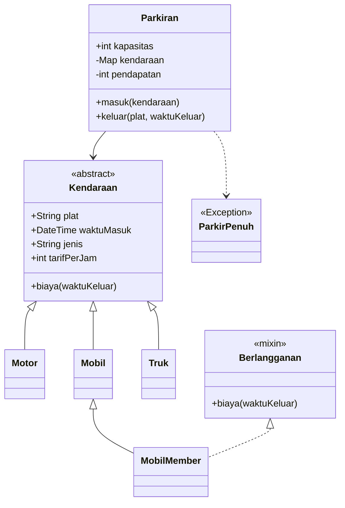

# Tugas Rutin 4 — Sistem Parkir Kampus

## Identitas Mahasiswa

- **Nama:** Syuhada Simbolon
- **NIM:** 4243550016
- **Mata Kuliah:** Pemrograman Mobile
- **Pertemuan:** 4
- **Judul Tugas:** Sistem Parkir Kampus

## Deskripsi Program

Sistem Parkir Kampus merupakan aplikasi berbasis console yang dibuat menggunakan bahasa pemrograman Dart.

Program mensimulasikan proses kendaraan masuk dan keluar melalui palang parkir otomatis, menghitung biaya berdasarkan jenis kendaraan dan lama parkir, serta menampilkan aktivitas parkir melalui Stream.

## Fitur Program

1. Mendukung kendaraan Motor, Mobil, dan Truk.
2. Menerapkan diskon 50% untuk Mobil Member.
3. Membatasi jumlah kendaraan berdasarkan kapasitas parkir.
4. Menolak kendaraan apabila parkiran penuh.
5. Menghitung tarif berdasarkan durasi parkir dengan pembulatan ke atas dan minimal satu jam.
6. Mensimulasikan palang otomatis menggunakan `Future.delayed()`.
7. Menampilkan aktivitas parkir menggunakan `StreamController.broadcast()`.
8. Menghitung total pendapatan parkiran.

## Cara Menjalankan

Buka terminal pada folder proyek, kemudian jalankan:

`dart run bin/sistem_parkir.dart`

## Struktur Kelas

Diagram kelas berikut menggambarkan hubungan antarkelas pada aplikasi.

## Dokumentasi Pengujian

### Pengujian Kendaraan Masuk

Program berhasil menerima tiga kendaraan dan menolak kendaraan keempat karena kapasitas parkir telah penuh.

### Pengujian Kendaraan Keluar

Program berhasil menghitung biaya parkir setiap kendaraan serta total pendapatan sebesar Rp28.500.

## Hasil Pengujian

| Kendaraan | Lama Parkir | Biaya |
|---|---|---:|
| Motor | 2 jam | Rp6.000 |
| Mobil | 3 jam | Rp15.000 |
| Mobil Member | 3 jam | Rp7.500 |
| **Total Pendapatan** | | **Rp28.500** |

## Penerapan Konsep OOP dan Async

Program Sistem Parkir Kampus menerapkan konsep pemrograman berorientasi objek untuk mengelola kendaraan dan transaksi parkir. Enkapsulasi diterapkan pada kelas `Parkiran` melalui penggunaan atribut privat `_kendaraan` dan `_pendapatan`. Kedua atribut tersebut tidak diakses langsung dari fungsi utama, melainkan melalui method dan getter yang tersedia. Pendekatan ini membantu menjaga konsistensi data.

Polimorfisme diterapkan melalui abstract class `Kendaraan` yang diwarisi oleh `Motor`, `Mobil`, dan `Truk`. Setiap subclass memiliki tarif parkir berbeda dan dapat diproses melalui `List<Kendaraan>`. Kelas `MobilMember` menggunakan mixin `Berlangganan` untuk menerapkan diskon sebesar 50% dengan mengubah perhitungan biaya.

Pemrograman asinkron diterapkan pada method `masuk()` dan `keluar()` menggunakan `Future.delayed()` untuk mensimulasikan proses palang parkir otomatis. Pemanggilan kedua method dilakukan menggunakan `await` agar hasil operasi dapat diproses secara berurutan. Selain itu, `StreamController.broadcast()` digunakan untuk mengirim informasi kendaraan masuk dan keluar kepada listener yang bertugas menampilkan aktivitas di layar pos jaga. Exception `ParkirPenuh` digunakan untuk menangani kondisi ketika kapasitas parkir sudah tercapai.

## Pemeriksaan Kode

Program telah diperiksa menggunakan:

`dart format .`

`dart analyze`

Hasil pemeriksaan:

`No issues found!`

## Pernyataan Penggunaan AI

ChatGPT digunakan sebagai alat bantu dalam memahami materi OOP dan pemrograman asinkron pada Dart, menyusun kode awal, serta membantu menjelaskan dan memeriksa implementasi program. Program kemudian dijalankan dan diuji menggunakan Visual Studio Code.